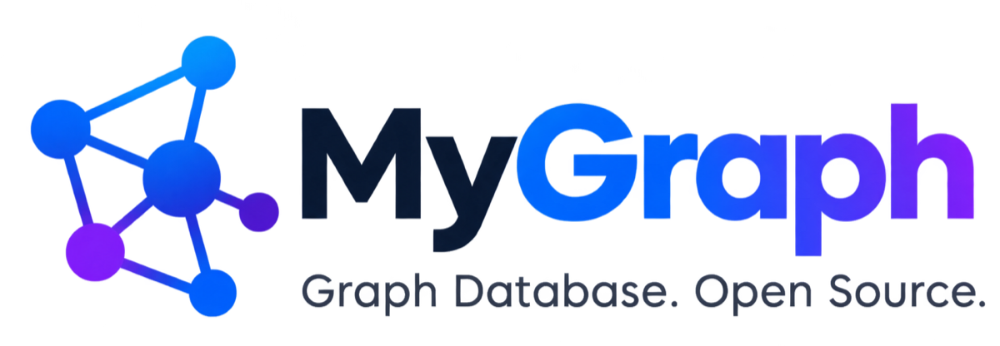

<p align="center">
  <picture>
    <source media="(prefers-color-scheme: dark)" srcset="branding/banner-dark.png">
    
  </picture>
</p>

<p align="center">
  A property-graph database written in Rust, queried with Cypher.
</p>

<p align="center">
  <a href="https://github.com/julioacontreras/my-graph/actions/workflows/docker.yml"></a>
  <a href="https://hub.docker.com/r/julioacontreras/mygraph"></a>
  <a href="https://pypi.org/project/mygraph-client/"></a>
  <a href="rust-toolchain.toml"></a>
  <a href="LICENSE"></a>
</p>

<p align="center">
  <a href="https://julioacontreras.github.io/my-graph/"><strong>Website</strong></a> ·
  <a href="#installation"><strong>Installation</strong></a> ·
  <a href="#usage"><strong>Usage</strong></a> ·
  <a href="#reference"><strong>Reference</strong></a> ·
  <a href="PROTOCOL.md"><strong>Protocol</strong></a> ·
  <a href="python/README.md"><strong>Python client</strong></a> ·
  <a href="CHANGELOG.md"><strong>Changelog</strong></a>
</p>

---

MyGraph stores a directed property graph (labelled nodes, typed
relationships, properties) with a write-ahead log and crash recovery. You
can embed it in a Rust program or run it as a server and talk to it from
the `mygraph` CLI, the Python client, or any client that speaks
[protocol v1](PROTOCOL.md).

> [!TIP]
> **Using the database, or an AI agent?** Read [Installation](#installation),
> [Usage](#usage) and [Reference](#reference). Everything there was checked
> against v0.2. If a feature is not listed there or in [Status](#status),
> assume it is not supported.

## Contents

- [Installation](#installation)
- [Usage](#usage)
- [Reference](#reference)
- [Status](#status)
- [Development](#development)
- [Releasing](#releasing)
- [Architecture](#architecture)
- [License](#license)

## Installation

| What | Where | Install |
|---|---|---|
| Server (Docker image, amd64 + arm64) | Docker Hub [`julioacontreras/mygraph`](https://hub.docker.com/r/julioacontreras/mygraph), also `ghcr.io/julioacontreras/mygraph` | `docker pull julioacontreras/mygraph:latest` |
| Python client + `mygraph-client` command | PyPI [`mygraph-client`](https://pypi.org/project/mygraph-client/) | `pip install mygraph-client` |
| Rust CLI `mygraph` | this repository | `cargo install --git https://github.com/julioacontreras/my-graph.git mygraph-cli` |

### Server

#### [Docker Compose](https://docs.docker.com/compose/)

From the repository root (the [`docker-compose.yml`](docker-compose.yml) is
already there):

```bash
docker compose up -d            # start on port 6660, data in volume mygraph-data
docker compose ps               # check that it is running
docker compose logs -f mygraph  # follow the logs
docker compose down             # stop it; the data stays in the volume
docker compose down -v          # stop it and DELETE all data
docker compose pull && docker compose up -d   # update to the latest image
```

Outside the repository, save this as `docker-compose.yml` and run the same
commands:

```yaml
services:
  mygraph:
    image: julioacontreras/mygraph:latest   # or ghcr.io/julioacontreras/mygraph:latest
    ports:
      - "6660:6660"        # change the left side to use another host port
    volumes:
      - mygraph-data:/data
    init: true
    restart: unless-stopped

volumes:
  mygraph-data:
```

#### Docker

```bash
docker run -d -p 6660:6660 -v mygraph-data:/data julioacontreras/mygraph:latest
```

The image contains only the server. It has no shell and no CLI, so
`docker compose exec` cannot run queries. Use one of the clients below from
your machine.

#### Building from source

```bash
cargo run -p mygraph-server -- start --port 6660 --data ./data
```

This listens on 127.0.0.1 only. Add `--host 0.0.0.0` to accept remote
connections. Without `--data` all data is kept in memory and is lost when
the server stops.

No authentication is needed. `AUTH` is accepted but not checked.

### Clients

#### Python CLI and library

```bash
pip install mygraph-client
```

Without PyPI, install it from this repository:

```bash
pip install "git+https://github.com/julioacontreras/my-graph.git#subdirectory=python"
```

It uses the standard library only. See [python/README.md](python/README.md).

#### Rust CLI

```bash
cargo install --git https://github.com/julioacontreras/my-graph.git mygraph-cli
```

Or, inside this repository: `cargo build --release -p mygraph-cli`, which
builds `target/release/mygraph`.

#### Rust library (embedded)

The `mygraph` crate is not on crates.io yet. Add it as a git dependency:

```toml
[dependencies]
mygraph = { git = "https://github.com/julioacontreras/my-graph.git" }
```

## Usage

### Connect

Both CLIs connect to `localhost:6660` by default. Use `--host` / `--port`
for another address.

**Python CLI (`mygraph-client`):**

```bash
mygraph-client "MATCH (n) RETURN n LIMIT 10;"    # one query, table output
mygraph-client --json "MATCH (n) RETURN n;"      # one JSON object per line
mygraph-client --host db.example.com --port 7000 "RETURN 1;"
mygraph-client <<'CYPHER'                        # multi-line script from stdin
MATCH (u:User)
RETURN u.name AS name;
CYPHER
```

Without installing it, `python3 -m mygraph` (from `python/`) does the same.

**Rust CLI (`mygraph`):**

```bash
mygraph query --host localhost --json "MATCH (n) RETURN n LIMIT 10"   # one query
mygraph shell --host localhost                                        # interactive shell
```

When you pass `--host` or `--port`, the Rust CLI connects to a server. The
shell shows the current database and schema in the prompt. Each statement
ends with `;`. Use `BEGIN;`, `COMMIT;` and `ROLLBACK;` for transactions, and
`EXIT;` to leave:

```text
$ mygraph shell --host localhost
MyGraph v0.2.0 (connected to localhost:6660)
End statements with `;`. Type EXIT; to quit.
mygraph[default/public]> MATCH (n) RETURN count(n) AS c;
+---+
| c |
+---+
| 0 |
+---+
1 row
(0.3 ms)
```

Without `--host` or `--port`, the Rust CLI runs embedded, without a
server: `--data DIR` stores data on disk, and without `--data` the data is
kept in memory. Do not open a directory in embedded mode while a server is
using it, because the directory is locked.

> [!IMPORTANT]
> For agents, `--json` is the format to parse. The CLIs **cannot pass
> parameters** (`$name` fails with `missing parameter`), so put literal
> values in the query, or use the Python or Rust library when the values
> come from user input.

### Create data

```bash
mygraph query --host localhost "CREATE INDEX FOR (u:User) ON (u.name)"
mygraph query --host localhost "CREATE (a:User {name: 'Alice', age: 30})-[:KNOWS {since: 2020}]->(b:User {name: 'Bob', age: 25})"
```

### Query

```bash
mygraph query --host localhost --json "MATCH (u:User)-[r:KNOWS]->(f) RETURN u, r, f.name AS friend"
```

```json
[{"u":{"id":0,"labels":["User"],"properties":{"age":30,"name":"Alice"}},
  "r":{"id":0,"type":"KNOWS","start":0,"end":1,"properties":{"since":2020}},
  "friend":"Bob"}]
```

### Use a database and a schema

`USE` lasts only for the session, and each CLI call is a new session, so
put it in the same script as the queries that need it:

```bash
mygraph query --host localhost "CREATE DATABASE shop"
mygraph query --host localhost "USE DATABASE shop; MATCH (n) RETURN count(n) AS c"
```

### From code

**Python** (see [python/README.md](python/README.md)):

```python
import mygraph

with mygraph.connect("localhost", 6660) as db:
    db.run("CREATE (u:User {name: $name})", name="Alice")
    alice = db.create_node("User", {"name": "Carol"})
    db.find_nodes("User", {"name": "Carol"})
    db.update_node(alice.id, {"age": 26})
    db.delete_node(alice.id)
```

**Rust, embedded:**

```rust
use mygraph::{params, Database};

let db = Database::open("./mygraph_data")?;   // or Database::in_memory()
db.execute("CREATE (a:User {name: $a})-[:KNOWS]->(b:User {name: $b})", params! { "a" => "Alice", "b" => "Bob" })?;
let r = db.execute("MATCH (u:User)-[:KNOWS]->(f) RETURN u.name, f.name", params! {})?;

let mut tx = db.begin_transaction()?;
tx.execute("MATCH (u:User {name: 'Bob'}) SET u.age = 30", params! {})?;
tx.commit()?;
```

## Reference

### Result format

`mygraph query --json` prints one JSON array with one object per row. The
keys are the column names. A column without `AS` is named after its
expression text, for example `n.name` or `count(n)`. Use `AS` to get
predictable keys.

- Node: `{"id", "labels", "properties"}`. Relationship: `{"id", "type", "start", "end", "properties"}`.
  Path: `{"nodes": [node, ...], "relationships": [relationship, ...]}`.
- No rows: `[]`. A write without `RETURN` prints `[]` with `--json`. Without
  `--json` it prints a summary such as
  `nodes created: 2, relationships created: 1, properties set: 4, labels added: 2`.
- Errors go to stderr as `error: ...` with exit status 1. Syntax errors give
  the position, for example `syntax error at line 1, column 10: ...`.

`mygraph-client --json` (Python) prints one JSON object per line, one line
per record.

### Sessions, databases and scripts

- A new connection starts in database `default`, schema `public`.
- `USE DATABASE` / `USE SCHEMA` last only for the session. **Each CLI call
  is a new session**, so put `USE` in the same script as the queries that
  need it.
- One query string can contain several statements separated by `;`. The
  output is the result of the last statement. Outside a transaction each
  statement is committed on its own.
- Node and relationship ids are integers given by the engine. Use
  `id(n)` to match them: `MATCH (n) WHERE id(n) = 0 RETURN n`.
- Property indexes are **not** created automatically. See
  [Indexes](#indexes-you-create-them).
- Scripts that only read (no `CREATE`, `SET`, `REMOVE` or `DELETE`) run at
  the same time as each other; anything that writes runs alone. An open
  transaction blocks all other connections. Keep it short.

### Cypher examples

```cypher
// Create nodes and a relationship in one pattern
CREATE (a:User {name: 'Alice', age: 30})-[:KNOWS {since: 2020}]->(b:User {name: 'Bob', age: 25})

// Index the lookup key, then connect existing nodes (there is no MERGE: run MATCH first to avoid duplicates)
CREATE INDEX FOR (u:User) ON (u.name)
MATCH (a:User {name: 'Alice'}), (c:User {name: 'Carol'}) CREATE (a)-[:KNOWS]->(c)
UNWIND $edges AS e MATCH (a:User {name: e.from}), (b:User {name: e.to}) CREATE (a)-[:KNOWS]->(b)

// Read with a filter, ordering and paging
MATCH (u:User) WHERE u.age >= 18 AND u.name STARTS WITH 'A'
RETURN u.name AS name, u.age AS age ORDER BY age DESC SKIP 0 LIMIT 20

// Traverse a fixed number of hops
MATCH (a:User {name: 'Alice'})-[:KNOWS]->()-[:KNOWS]->(fof) RETURN DISTINCT fof.name AS name

// Variable-length paths: *, *3, *1..3, *2.., *..4 (every relationship is used at most once)
MATCH (a:User {name: 'Alice'})-[:KNOWS|FOLLOWS*1..3]->(x) RETURN DISTINCT x.name AS name
MATCH p = (a:User {name: 'Alice'})-[r:KNOWS*]->(b) RETURN b.name, length(p), size(r)

// Shortest paths between bound nodes (WHERE is checked after the search)
MATCH (a:User {name: 'Alice'}), (b:User {name: 'Dave'}), p = shortestPath((a)-[:KNOWS*..10]-(b))
RETURN length(p) AS hops, nodes(p) AS people

// Lightest path: the smallest sum of a relationship property (see Shortest paths)
MATCH (a:City {name: 'Madrid'}), (b:City {name: 'Lisboa'}), p = shortestPath((a)-[:ROAD*]-(b), {weight: 'km'})
UNWIND relationships(p) AS r RETURN length(p) AS legs, sum(r.km) AS km

// Aggregate
MATCH (u:User) RETURN count(u) AS users, avg(u.age) AS avg_age, collect(u.name) AS names

// Group with WITH
MATCH (u:User)-[:KNOWS]->(f) WITH u, count(f) AS friends WHERE friends > 1 RETURN u.name AS name, friends

// Optional relationships
MATCH (u:User) OPTIONAL MATCH (u)-[:KNOWS]->(f) RETURN u.name AS name, f.name AS friend

// Update and delete
MATCH (u:User {name: 'Bob'}) SET u.age = 26, u:VIP
MATCH (u:User {name: 'Bob'}) SET u += {city: 'Madrid'} REMOVE u.age
MATCH (u:User {name: 'Bob'}) DETACH DELETE u

// Lists
UNWIND [1, 2, 3] AS x RETURN x * 2 AS y

// Databases and schemas
CREATE DATABASE shop; SHOW DATABASES; USE DATABASE shop; CREATE SCHEMA s1; USE SCHEMA s1; SHOW SCHEMAS
```

### Operators and functions

**Operators:** `= <> < <= > >=`, `AND OR XOR NOT`, `+ - * / % ^`,
`IN`, `STARTS WITH`, `ENDS WITH`, `CONTAINS`, `IS NULL`, `IS NOT NULL`,
`CASE WHEN ... THEN ... ELSE ... END`. Comments are `//` and `/* */`.
Identifiers with spaces or reserved words go in backticks: `` `my label` ``.

**Functions** (names are case-insensitive):

| Kind | Functions |
|---|---|
| Aggregation | `count(*)`, `count(x)`, `sum`, `avg`, `min`, `max`, `collect` |
| Graph | `id`, `labels`, `type`, `properties`, `keys`, `startNode`, `endNode` |
| Path | `length`, `nodes`, `relationships` |
| String | `toUpper`, `toLower`, `trim`, `ltrim`, `rtrim`, `replace`, `split`, `substring`, `left`, `right`, `reverse`, `size` |
| List | `size`, `head`, `last`, `tail`, `range`, `reverse` |
| Number | `abs`, `ceil`, `floor`, `round`, `sign`, `sqrt` |
| Conversion | `toInteger`, `toFloat`, `toString`, `toBoolean`, `coalesce` |
| Other | `length`, `timestamp` |

> [!WARNING]
> **Not supported in v0.3:** `MERGE` and regular expressions (`=~`) fail
> with `syntax error ... not supported yet`. Constraints, composite indexes
> and `CALL` / procedures fail with an ordinary syntax error. To do an
> upsert, run `MATCH` first and `CREATE` only when it returns no rows.

### Indexes: you create them

**What is automatic** (nothing to do):

- The label index: `MATCH (n:User)` only visits `:User` nodes.
- Lookups by id: `MATCH (n) WHERE id(n) = $id` (or `id(n) IN $ids`) goes
  straight to the node, and `MATCH (a)-[r]->(b) WHERE id(r) = $id` straight
  to the relationship.
- The relationship type index: `MATCH (a)-[:RARE]->(b)` starts from the
  `:RARE` relationships when they are fewer than the nodes it would scan.
- The query planner: each pattern starts from its most selective node (a
  variable that is already bound, then `id()`, then an index, then the
  label with the fewest nodes), and every `WHERE` condition joined by `AND`
  is checked as soon as its variables are bound. You can write the pattern
  in any order.

**What is not automatic:** indexes on properties. Without an index,
`MATCH (n:User {name: 'Alice'})` reads every `:User` node. With 50,000
nodes and 100,000 relationships, a batch load that connects nodes by a key
goes from many minutes to under a second once that key has an index.

```cypher
CREATE INDEX FOR (u:User) ON (u.name)        // Neo4j syntax; optional name: CREATE INDEX user_name FOR ...
CREATE INDEX ON :User(name)                  // Memgraph syntax; does nothing if the index exists
CREATE INDEX IF NOT EXISTS FOR (u:User) ON (u.name)
SHOW INDEXES                                 // name, label, property, entries
DROP INDEX user_name                         // by name (the default name is index_<Label>_<property>)
DROP INDEX ON :User(name)                    // by label and property
```

Create an index on every property you use to find nodes, in particular the
key used to connect nodes while loading. You can create it before or after
loading: an index on existing data is filled when it is created. Indexes
are kept up to date on every write, are saved with the data, and belong to
the current schema (create them in each schema that needs them).

An index is used when the node pattern has the indexed label and the
property is compared for equality with a value known at that point:

| Uses the index on `:User(name)` | Does not |
|---|---|
| `MATCH (u:User {name: $n})` | `MATCH (u {name: $n})` (no label) |
| `MATCH (u:User) WHERE u.name = $n` | `WHERE u.name STARTS WITH 'A'`, `<`, `>`, `CONTAINS` |
| `MATCH (u:User) WHERE u.name IN $names` | `WHERE toLower(u.name) = 'alice'` |
| `UNWIND $rows AS r MATCH (u:User {name: r.name})` | `WHERE u.name = 'a' OR u.name = 'b'` (use `IN`) |

Indexed values are booleans, integers, floats and strings (`1` and `1.0`
are the same key). Lists and maps are not indexed. A lookup with one of them
falls back to a scan, and so does a lookup with an integer beyond ±2^53.
Results are the same with or without an index, only the speed changes.

### Shortest paths

`shortestPath((a)-[*]->(b))` finds a path with the fewest relationships,
searching from both ends at once. Add `{weight: 'property'}` to find the
path with the smallest sum of that relationship property instead
(bidirectional Dijkstra):

```cypher
MATCH (a:Stop {id: $from}), (b:Stop {id: $to}), p = shortestPath((a)-[:LINK*]->(b), {weight: 'minutes'})
UNWIND relationships(p) AS r RETURN nodes(p) AS stops, sum(r.minutes) AS minutes
```

- Weights must be non-negative numbers. A relationship the search reaches
  with a missing, negative or non-numeric weight makes the query fail.
- A weighted search needs a relationship of any length (`-[*]->`, `-[:T*]-`):
  a maximum length (`*..5`) and `allShortestPaths` are not supported with a
  weight yet.
- When several paths are equally short, any of them may be returned.

Answers are cached per schema (10,000 searches by default;
`Config::default().path_cache_entries(n)`, 0 turns the cache off). A cached
answer is dropped as soon as a change could affect it: a new relationship
of a type the search follows, a deleted relationship on the path, a heavier
weight on the path, or a lighter (or missing, or invalid) weight anywhere.
Other changes keep it, so repeated searches stay fast while the graph is
being updated, and results are always the same as without the cache.

## Status

Current version: **v0.3**.

| Area | Implemented |
|---|---|
| Model | Directed property graph: nodes with multiple labels, typed relationships, properties (`null`, bool, int, float, string, bytes, list, map) |
| Databases / schemas | Multiple databases with isolated schemas; `CREATE/DROP/USE DATABASE`, `CREATE/DROP/USE SCHEMA`, `SHOW DATABASES/SCHEMAS` |
| Cypher | `MATCH`, `OPTIONAL MATCH`, `WHERE`, variable-length relationships (`-[:T*1..5]->`), named paths (`p = ...`), `shortestPath` / `allShortestPaths`, `CREATE`, `SET` (`=`, `+=`, labels), `REMOVE`, `DELETE`, `DETACH DELETE`, `UNWIND`, `WITH`, `RETURN` (`DISTINCT`, `ORDER BY`, `SKIP`, `LIMIT`), `count/sum/avg/min/max/collect`, `CASE`, parameters, scalar functions; errors carry line/column |
| Indexes and planning | Label and relationship-type indexes; property equality indexes (`CREATE INDEX FOR (n:L) ON (n.p)` or `CREATE INDEX ON :L(p)`, `DROP INDEX`, `SHOW INDEXES`), used by inline properties, `WHERE n.p = x` and `IN`; `id(n) = x` and `id(r) = x` lookups; each path starts from its most selective node or relationship and `WHERE` is checked as soon as its variables are bound |
| Paths | Bidirectional breadth-first `shortestPath`, weighted `shortestPath(..., {weight: 'p'})` (bidirectional Dijkstra), `allShortestPaths`; per-schema cache of path searches with change-based invalidation |
| Transactions | Auto-commit per statement; explicit transactions with commit/rollback (rollback on drop); statement-level atomicity; read-only scripts run concurrently |
| Storage | WAL (CRC32, fsync on commit) + snapshot checkpoints, crash recovery, torn-write detection, exclusive directory lock |
| API | Embedded `Database::in_memory()` / `Database::open(path_or_config)`, `params!` |
| CLI | `mygraph shell` / `mygraph query`, embedded or connected to a server |
| Server | `mygraph-server start`: TCP, [protocol v1](PROTOCOL.md), one session per connection, explicit transactions |
| Python client | [`python/`](python/README.md): `run(cypher)`, CRUD helpers for nodes/relationships, transactions; standard library only |

**Not yet:** `MERGE`, `UNION`, range or composite indexes, a cost-based
planner, MVCC/concurrent writers, page-based storage, authentication
(`AUTH` is accepted but not checked), TLS, import/export, security.

## Development

```bash
cargo test --workspace                          # Rust tests
(cd python && python3 -m unittest discover -s tests)   # Python tests
cargo fmt --all -- --check && cargo clippy --workspace --all-targets

cargo run -p mygraph --example embedded         # embedded example
cargo run --release -p mygraph --example bench        # latency benchmark
cargo run --release -p mygraph --example tree_volume  # 1M-node tree: load time and memory
cargo run -p mygraph-cli -- shell --data ./data # embedded shell on disk
cargo run -p mygraph-server -- start --port 6660 --data ./data
python3 python/examples/crud.py                 # needs the server above
```

## Releasing

Versions are listed in [CHANGELOG.md](CHANGELOG.md).

### Server (Docker image)

The workflow [`.github/workflows/docker.yml`](.github/workflows/docker.yml)
builds the image for amd64 and arm64 and pushes it to Docker Hub
(`julioacontreras/mygraph`) and GHCR (`ghcr.io/julioacontreras/mygraph`)
when a tag that starts with `v` is pushed. A tag `vX.Y.Z` publishes the
image tags `X.Y.Z`, `X.Y`, `latest` and `sha-<commit>`. It needs the
repository variable `DOCKERHUB_USERNAME` and the secret `DOCKERHUB_TOKEN`.

1. Increase `version` in the root [`Cargo.toml`](Cargo.toml)
   (`[workspace.package]`), for example `0.2.0` → `0.2.1`. Every crate,
   the CLI banner and the server's handshake take it from there.
2. Add the version to [CHANGELOG.md](CHANGELOG.md), with upgrade notes if
   the snapshot or protocol format changed.
3. Check, then commit and push to `main`:

   ```bash
   cargo fmt --all -- --check && cargo clippy --workspace --all-targets && cargo test --workspace
   (cd python && python3 -m unittest discover -s tests)
   git push origin main
   ```

4. Create and push the tag (`v` + the version in `Cargo.toml`):

   ```bash
   git tag v0.2.1
   git push origin v0.2.1
   ```

5. Check the run in the repository's **Actions** tab, then
   `docker pull julioacontreras/mygraph:0.2.1`.

To build the image locally: `docker build -t mygraph:dev .`

### Python client (PyPI)

See [python/README.md](python/README.md#releasing-to-pypi). It has its own
version and its own tags (`py-vX.Y.Z`). Release it too when the protocol
changes, so the client can read the new values.

## Architecture

| Crate | Responsibility | Depends on |
|---|---|---|
| `mygraph-core` | Values, graph, catalog (databases/schemas), change journal | — |
| `mygraph-cypher` | Lexer, parser, AST, semantic checks, executor | core |
| `mygraph-storage` | Binary format, WAL, snapshots, recovery | core |
| `mygraph` | Public embedded API | core, cypher, storage |
| `mygraph-cli` | `mygraph` binary | mygraph |
| `mygraph-protocol` | Wire protocol v1: frames, value codec, messages | core |
| `mygraph-server` | `mygraph-server` binary (TCP) | mygraph, protocol |

All mutations are invertible `Change` records applied through one entry point
(`Graph::apply`). The same records are the redo log written to the WAL and,
inverted, the undo log used for rollback.

### Design decisions (v0.1)

- **Storage:** the whole catalog is kept in memory and persisted as WAL plus
  full snapshots, not in pages with a buffer pool. Properties are kept in
  compact sorted arrays with shared key names, and snapshots are written
  and read in chunks, so a graph of 1M nodes and 1M relationships needs
  about 1 GB (1.5 GB peak while loading). The `Store`
  API is designed so the page-based store can replace it in Phase 3.
  `cache_size_mb` is accepted but has no effect yet.
- **Concurrency:** one reader-writer lock per instance. Read-only scripts
  share it, so each sees a consistent graph; scripts that write, DDL and
  explicit transactions hold it alone until they finish. MVCC is Phase 5.
- **Checkpoints** happen when the WAL reaches a size threshold (default
  64 MiB), when `checkpoint()` is called, and on close. They are not time-based
  yet.
- **`Value::Map`** uses `BTreeMap` (not `HashMap`) so iteration order and the
  binary encoding are deterministic.
- **Server:** one OS thread per connection over `std::net`, not Tokio.
  Read-only statements from different connections run in parallel; writes
  are serialized. Each connection gets its own `Session`
  (`Database::session()`), so `USE DATABASE` does not leak between clients.
- **Leniency:** clauses may follow `CREATE` without a `WITH` in between.

## License

[MIT](LICENSE) © 2026 Julio Contreras
